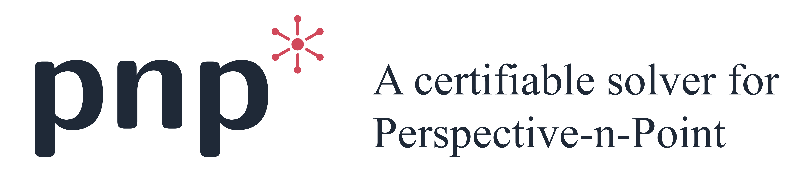

<div align="center">
  
</div>

Perspective-n-Point solvers that recover camera pose from 3D-2D (pinhole model) or 3D-bearing (spherical model) correspondences. This library is written in Rust and we support Rust, C++, and Python interfaces.

```bibtex
@misc{CER26,
  title        = {PnP*: A certifiable solver for Perspective-n-Point},
  author       = {Bang-Shien Chen and Caitrin E. Eaton and David M. Rosen},
  journal      = {arXiv preprint arXiv:2610.31797},
  year         = {2026}
}
```

- [:gear: Set-up](#gear-set-up)
  - [:apple: macOS](#apple-macos)
  - [:penguin: Ubuntu 22.04](#penguin-ubuntu-2204)
  - [:checkered\_flag: Test](#checkered_flag-test)
- [:rocket: Examples](#rocket-examples)
  - [:crab: Rust](#crab-rust)
  - [:croissant: C++](#croissant-c)
  - [:snake: Python](#snake-python)
- [:coffee: Acknowledgment](#coffee-acknowledgment)

## :gear: Set-up 

A MOSEK [license](https://www.mosek.com/license/request/) is required (free for academic use). Place it at `~/mosek/mosek.lic`.

### :apple: macOS

```bash
# rust
curl --proto '=https' --tlsv1.2 -sSf https://sh.rustup.rs | sh -s -- -y
source "$HOME/.cargo/env"
# bindings
brew install cmake eigen

cargo build --release
```

### :penguin: Ubuntu 22.04

```bash
sudo apt install -y build-essential curl bzip2
# rust
curl --proto '=https' --tlsv1.2 -sSf https://sh.rustup.rs | sh -s -- -y
source "$HOME/.cargo/env"
# bindings
sudo apt install -y cmake libeigen3-dev patchelf

cargo build --release
```

### :checkered_flag: Test

```bash
cargo test --release
```

## :rocket: Examples

### :crab: Rust

```bash          
cargo build --release --examples

./target/release/examples/demo_pinhole
# ./target/release/examples/demo_spherical
```
See [docs/rust](docs/rust.md) for API reference.

### :croissant: C++

```bash
cargo build -p pnp-cxx --release

cmake -B example/cxx/build example/cxx
cmake --build example/cxx/build
./example/cxx/build/demo_pinhole
# ./example/cxx/build/demo_spherical
```
See [docs/cxx](docs/cxx.md) for API reference.

### :snake: Python

```bash
conda create -n pnp python=3.13 -y
conda activate pnp
pip install maturin numpy

maturin develop --release -m pnp-python/Cargo.toml

python example/python/demo_pinhole.py
# python example/python/demo_spherical.py
```
See [docs/python](docs/python.md) for API reference.

## :coffee: Acknowledgment
- Local solvers were modified from [OpenCV](https://github.com/opencv/opencv) and [OpenGV](https://github.com/laurentkneip/opengv), we thank the open-source projects. 
- BnB solver is our reimplementation of [Optimal Estimation of Perspective Camera Pose](https://doi.org/10.1109/ICPR.2006.909).
